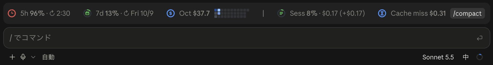

# cc-desktop-statusline

A status band above the prompt in the Claude Code desktop app, built as a Claude Code
mod (a plugin of function hooks).



In the terminal, Claude Code's `statusLine` setting covers this. The desktop app has no status
line, but mods can draw above its prompt, so this plugin puts the numbers you keep checking in
one row there.

## What it shows

| Item | Meaning |
|---|---|
| **5h 40% · ↻ 2:30** | Your plan's 5-hour limit and when it resets. |
| **7d 5% · ↻ Fri 10/9** | Your plan's weekly limit and when it resets. |
| **Oct $16.3** | API-equivalent cost this calendar month, across all local sessions. |
| **▦▦▦▦** | Tokens per day this month as a GitHub-style contribution grid: 3 rows, filled top to bottom. Today is lightened; days ahead are dimmed. |
| **Sess 46%** | How full this conversation's context window is. |
| **$15.2 (+$0.21)** | API-equivalent cost of this session so far, and of the last turn. |
| **Cache miss $3.71** | What re-caching this conversation would cost if the prompt cache expired: the cache write alone, at the 1-hour rate. A long conversation makes it grow; compacting brings it down. After an hour idle it turns yellow as **Cache expired · next $3.71**. Right after a compaction it shows `-` until the next response. |
| **/compact** | Runs Claude Code's `/compact`. Shown between turns. |

The rings turn yellow at 50% and red at 80%. In the terminal a shorter version is drawn as one
line of text (not yet tested there).

## Install

```bash
claude plugin marketplace add GoatEatAny/cc-desktop-statusline
claude plugin install cc-desktop-statusline@cc-desktop-statusline
```

Start a new session and the band appears above the prompt.

To remove it:

```bash
claude plugin uninstall cc-desktop-statusline@cc-desktop-statusline
claude plugin marketplace remove cc-desktop-statusline
```

## Pixel pet (optional)

[pixel-pet](plugins/pixel-pet) is a second mod in this marketplace: a herd of pixel-art cats in
the same band. They cheer when a turn ends, grow rounder as the context fills, sleep under a
futon once the prompt cache goes cold, and a beckoning cat beside the bar offers `/compact`
(or `/clear`). The band still opens on the status band; the ◒ / ◓ switch at its right end
turns to the pets (and back), and the choice is kept. Its
words are in Japanese.

It depends on the status band (its other view), so the status band is installed with it:

```bash
claude plugin install pixel-pet@cc-desktop-statusline
claude plugin install pixel-pet-dog@cc-desktop-statusline   # optional: a dog, then /pet dog
```

Pets are data, not code: [pixel-pet-dog](plugins/pixel-pet-dog) is a complete pet pack to copy,
and pixel-pet's [README](plugins/pixel-pet/README.md) explains how to draw one.

## Requirements

- **Claude Code with mod support.** Tested with the desktop app on Claude Code 2.1.286.
  Mods are new and their API may change.
- **python3** 3.8 or later on your `PATH` (standard library only). On macOS, install the Command
  Line Tools with `xcode-select --install` if you don't have it. Without python3 the band shows
  the plan limits, the context and a one-line hint instead of the costs.
- **macOS or Linux.** Windows is not supported yet.
- **A Claude subscription** for the 5h / 7d figures. With an API key Claude Code reports no plan
  limits, so those show `-`.

## How the numbers are computed

- **Costs are API-equivalent estimates, not your bill.** On a Claude subscription you pay the
  plan price; this shows what the same tokens would cost on the API. Each response's input,
  output, cache-write (5-minute at 1.25x input, 1-hour at 2x) and cache-read tokens are priced
  from a table in [`scripts/usage.py`](scripts/usage.py) (`PRICES_AS_OF`); fast-mode responses
  count double. A model the table does not list, including a newer point release, is marked `?`
  instead of being guessed.
- **Only local transcripts are counted.** The script reads the JSONL files Claude Code writes
  under `~/.claude/projects` (or `$CLAUDE_CONFIG_DIR/projects`). Cloud sessions and claude.ai
  chats are not on your machine, so they are not included. The 5h / 7d percentages come from
  Claude Code itself and do cover all your usage.
- **The last turn** is everything after the last message you typed that got an answer in this
  session, subagents included.
- **The cache miss** assumes the one-hour cache Claude Code uses on a subscription within its
  usage limits, so it is priced at the 1-hour write rate and turns into **Cache expired** after
  an hour. With a shorter cache (for example on an API key, where it lasts 5 minutes) it
  overstates the cost and turns yellow later than it should.
- **Dates** use your machine's local time zone.

Parsed transcripts are cached in `$XDG_CACHE_HOME/cc-desktop-statusline/` (default
`~/.cache/cc-desktop-statusline/`), so each refresh only re-reads files that changed. The band
refreshes when a turn ends, and at midnight.

## Privacy and cost

- No network requests. Nothing leaves your machine.
- The band itself makes no model calls and uses no tokens. The /compact button runs Claude
  Code's normal `/compact`, which does.
- It reads your local transcripts to count tokens. The cache holds file paths, timestamps,
  message ids and token counts, never message text.

## License

MIT. Not affiliated with or endorsed by Anthropic.
