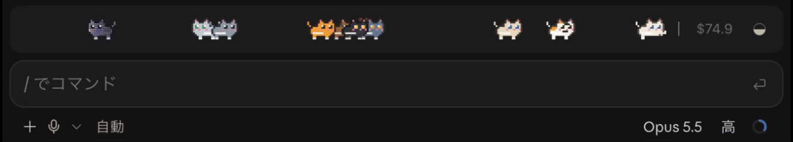

# pixel-pet

<picture>
  <source media="(prefers-color-scheme: dark)" srcset="../../docs/pixel-pet-dark.gif">
  
</picture>

A herd of pixel-art pets in the band above the prompt, reacting to your session:

- They cheer when a turn ends, and nap when left alone.
- They grow rounder as the context window fills (at 40%, 60% and 80%).
- They sleep under a futon once the prompt cache has gone cold.
- A beckoning figurine beside the bar offers `/compact` (or `/clear`), and after a compaction
  the pets eat a reward.

The cat comes built in. Other pets come from **pet packs**, small mods of their own, and you can
[make your own](#making-your-own-pet).

## Install

```bash
claude plugin marketplace add GoatEatAny/cc-desktop-statusline
claude plugin install pixel-pet@cc-desktop-statusline
```

pixel-pet uses the [status band](../..) as its other view, so the status band is installed
with it. Start a new session and the band appears above the prompt.

## Using it

- **The switch.** The band opens on the status band. The ◒ / ◓ switch at its right end turns to
  the pets and back. The choice is kept for later sessions.
- **`/pet`** lists the pets there are. The one in the band is marked ●, and a pack's pet that
  could not be used is marked ✕ with the reason.
- **`/pet <id>`** puts that pet in the band, for example `/pet dog`. The choice is kept for later
  sessions. If its pack is removed later, the band goes back to the cat.

The pets' words are in Japanese.

## Making your own pet

A pet is data, not code: a handful of pixel-art drawings and a few words. pixel-pet moves every
pet the same way (it runs, leaps, rolls, sleeps and eats its reward), so a new animal is one
file of drawings and a hook of three lines. The easiest start is to copy the dog,
[pixel-pet-dog](../pixel-pet-dog), and change it.

Install pixel-pet first: a pack adds to pixel-pet's pets, and does nothing without it.

### 1. Copy the dog

```bash
git clone https://github.com/GoatEatAny/cc-desktop-statusline.git
cp -R cc-desktop-statusline/plugins/pixel-pet-dog ~/my-pet
```

The pack is four files:

| File | What it holds |
|---|---|
| `.claude-plugin/plugin.json` | The manifest: the pack's name, and pixel-pet as a dependency. |
| `hooks/hooks.json` | Names the hook module, `register.ts`. |
| `hooks/register.ts` | The hook that hands the pet to pixel-pet, under its id. |
| `hooks/dog.ts` | The pet itself: its drawings, colors and words. |

### 2. Rename it

Change these, so your pack does not collide with the dog:

| File | Change |
|---|---|
| `.claude-plugin/plugin.json` | `name` to your pack's name (`"my-pet"`), and `description`, `author`, `homepage`. Keep `"dependencies": ["pixel-pet"]`. |
| `hooks/register.ts` | The id, `dog` in `{ ...answer.value, dog: DOG }`, to your pet's id (`shiba`). This is what `/pet` takes. |
| `hooks/dog.ts` | `name: '犬'` to the name `/pet` shows (`'柴'`). You can rename the file and `DOG` too. |

An id is lowercase letters, digits and `-`. It must not be a built-in pet's (`cat`) or another
installed pack's (`dog`): a pack's pet under a built-in id is left out, and of two packs using
one id only one wins.

### 3. Draw it

Everything is drawn on one canvas, `width` (10 to 16, usually 16) by 12 sprite pixels. The pet
faces right, with its feet on the bottom row (rows 10 and 11 are the legs).

Each piece of art is a list of row strings, one letter per pixel, with `.` for nothing. Leave
the rows above a piece empty (`''`) so it sits where it belongs: the dog uses a small helper,
`above(n)`, for that. Pieces line up by where they are drawn, so a paw can reach a pixel or two
past the right edge.

| Letter | Means | Colored by |
|---|---|---|
| `k` | outline | the coat |
| `o` | fur | the coat |
| `w` | light fur (belly, muzzle) | the coat |
| `p` | pink (ears, nose, tongue) | the coat |
| `e` | eyes | the coat |
| `a`, `b` | patches, ears in another shade | coats that name them (others leave them out) |
| `L`, `P` | leg or tail, paw | the coat, by the theme (fur on dark, outline on light) |

Colors are `#hex` (`#rgb`, `#rrggbb`, or with alpha). Every coat names `k o w p e`. No palette
may name `L`, `P` or `u` (`u` marks the ultra coat).

These are the fields of a pet. Start by changing the colors in `coats` and the words, then
redraw the `body`, and the rest piece by piece.

| Field | Required | What to draw |
|---|---|---|
| `name`, `width`, `coats` | yes | Up to 10 coats (9 with `ultra`); the herd deals them out. |
| `body` | yes | Body and face, with no legs or tail, eyes open. |
| `eyes` | yes | `cover` paints the open eyes out; then the eyes for each mood (`happy`, `sleep`, `reward`…). |
| `poses.run`, `.stand`, `.sleep` | yes | The layers around the body: `behind` (legs) and `front` (tail, paws). |
| `poses.jump`, `.roll`, `.stretch`, `.groom`, `.scratch`, `.eat`, `.beckon` | no | Left out, the pet stands instead (the dog has no `groom`). A missing `jump` runs; a missing `eat` eats standing. |
| `fat` | no | Three rounder bodies, for 40%, 60% and 80% of the context. |
| `patches` | no | `a`/`b` marks drawn over the body. |
| `food` | no | The reward after `/compact`, up to three bites, in its own colors. |
| `futonTail` | no | What sticks out of the futon; rows as wide as the piece itself (up to 8). |
| `maneki` | no | The beckoning figurine, 16 × 12, in its own colors. Without it, the pet's `beckon` pose stands in, turned to face the bubble. |
| `ultra` | no | Where the Ultracode coat's dots sparkle. Without it, there is no ultra coat. |
| `lines`, `face` | yes | Words for each mood (the alt text), and a kaomoji for the terminal. One line each, up to 80 characters (`name` up to 20). |

A layer is a list of rows, or a flipbook, `{ frames: [rows, rows, …], each: seconds }` with
`each` from 0.05 to 5. The dog's standing tail wags this way. The body bobs, sinks, rocks and
chomps on its own; those moves are pixel-pet's.

pixel-pet's contract, [types/index.d.ts](types/index.d.ts), types every field. It is laid into
your pack's `.claude-plugin/types/pixel-pet/` when the pack loads, so
`import type { PixelPetSpec } from 'pixel-pet'` works in your editor.

### 4. Load it and try it

Check the manifest and the hook first:

```bash
claude plugin validate ~/my-pet
```

Then load the folder into Claude Code.

**In the terminal**, start a session with the folder:

```bash
claude --plugin-dir ~/my-pet
```

**In the desktop app**, which takes no flags, name the folder in the `env` block of
`~/.claude/settings.json` (your user settings, not a project's), then start a new session:

```json
{
  "env": {
    "CLAUDE_CODE_PLUGIN_DIRS": "~/my-pet"
  }
}
```

Several folders are separated by `:`. A desktop session reads the folder when it starts, so
start a new session after you change the art (or also set `"CLAUDE_CODE_PLUGIN_DIR_WATCH": "1"`
there, to reload on each save). Remove the line to unload the pack.

Then type `/pet`. Your pet appears in the list, and `/pet shiba` puts it in the band. If it is
marked ✕, the reason beside it says what to fix (see [Checks](#checks)). pixel-pet asks for its
pets when a session starts, on `/pet` and once a minute, so a pack that loads, reloads or is
removed shows up (or goes) within a minute.

### 5. Share it

To let others install your pet, put the pack in a GitHub repository of its own and add a
marketplace file, `.claude-plugin/marketplace.json`, beside `plugin.json`:

```json
{
  "name": "my-pet",
  "owner": { "name": "<your name>" },
  "plugins": [{ "name": "my-pet", "source": "./" }]
}
```

Others install pixel-pet first, then your pack:

```text
/plugin install my-pet --marketplace <owner>/<repo>
```

## How a pack hands over its pet

pixel-pet adds `pixelPet.pets` to the engine. When it asks for its pets, each pack's hook adds
its own to what the others answer:

```ts
import type { Register } from 'claude-code'
import { DOG } from './dog.ts'

export const register: Register = on => {
  on('pixelPet.pets', async ($, e, next) => {
    const answer = await next(e)
    return answer.deny !== undefined ? answer : { value: { ...answer.value, dog: DOG } }
  })
}
```

A hook sees the call's answer wrapped, as `{ value }` (or `{ deny }`, passed on as it is). Add
your pet to `value`, not beside it, or pixel-pet never sees it.

The manifest lists pixel-pet as a dependency, which also lays pixel-pet's types into the pack:

```json
{ "name": "pixel-pet-dog", "version": "0.1.0", "description": "A dog for pixel-pet", "dependencies": ["pixel-pet"] }
```

## Checks

Before drawing a pack's pet, pixel-pet checks it:

- Every value is of its kind: colors as `#hex`, the width a whole number from 10 to 16,
  flipbook times and ultra cells numbers on the canvas, words one short line.
- Each piece has at most 12 rows, each up to `width` + 4 wide, and each flipbook at most 8
  frames.
- Each pose is about as small as the cat's, so a herd of ten fits in the band's picture.

A pet that fails, or that throws, is left out and the band keeps its pet. `/pet` lists it with
✕ and the reason. A pack that never answers holds up only that asking, never the band.

## Previewing a pet without loading it

To see a pet before loading it, build it with `buildPet` from pixel-pet's `hooks/pet-kit.ts`
and put it on a page: `trunk(mood, coat, fat)` inside `<defs><g id="t0">…</g></defs>`, then
`body(mood, coat, pose, '<use href="#t0"/>', fat)`, with `css(coat, 0)` in a `<style>`, in an
`<svg>` 12 tall and `width` wide (a little more for reaching paws). `inspectPet(spec)` says what
the checks above would say.
